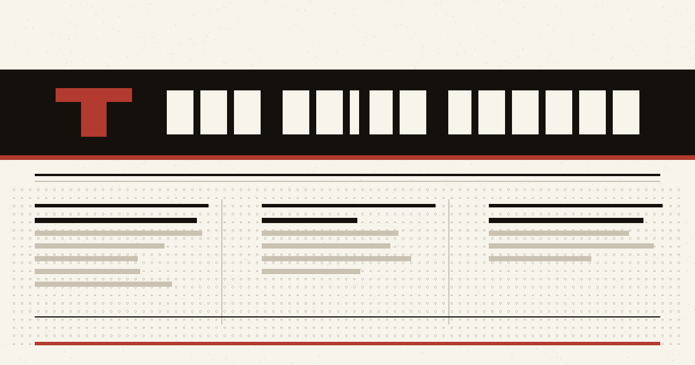

<p align="center">
  <h1 align="center">The Daily Ledger</h1>
  <p align="center">
    A print-style newspaper front end built with the Next.js App Router.
  </p>
</p>

<p align="center">
  <a href="https://github.com/CoderGamerUnknow/News-letter/actions/workflows/ci.yml"></a>
  <a href="https://github.com/CoderGamerUnknow/News-letter"></a>
  <a href="https://react.dev"></a>
  <a href="LICENSE"></a>
</p>

<p align="center">
  
</p>

---

The Daily Ledger is a complete newspaper front end generated from a single typed
dataset — no CMS, no database. It builds to static HTML you can deploy anywhere,
and it pulls real headlines from global news wires at build time, refreshing them
on the client without a rebuild.

## Highlights

- **Content at scale** — 20 hand-written features plus a seeded, deterministic
  wire-story generator (`lib/generate.ts`) that fills the edition to hundreds of
  stories. Bump `WIRE_STORY_COUNT` in `lib/articles.ts` to grow it.
- **Real news wire** — 36 RSS feeds across three regions are pulled at build
  time and shown in the breaking ticker, per-section "Live Wire" blocks and the
  region browser. Every region × sub-topic has at least two sources, a shared
  headline blocklist filters junk, and a feed that is down, slow or malformed is
  skipped rather than failing the build.
- **News by region** — `/news` groups live headlines into **Nigerian**, **Indian**
  and **Global** news, each listing its sub-topics as always-visible headings. The
  region tabs are a full ARIA tablist with arrow-key navigation.
- **Live updates** — the ticker and live wires poll `/api/live` every few minutes,
  so headlines refresh without a rebuild. The route caches the wire for three
  minutes and returns the newest headlines per region.
- **Instant routes** — article, section and author pages render a static shell and
  stream only the slug-dependent content; `proxy.ts` validates slugs up front so
  an unknown URL is a real 404 on the first request.
- **Search** — `/search` filters the whole edition in the browser.
- **Related stories** — scored by keyword overlap, not just section.
- **Real photos** — each card layers a seeded photo from `picsum.photos` over
  procedural SVG art, which acts as an offline fallback.
- **Social cards** — a generated OpenGraph/Twitter image per article.
- **Share + reactions** — Web Share / copy-link and local-only reaction marks.
- **Pagination** — section grids reveal a page at a time with "Load more".

## Tech stack

| Layer | Choice |
| --- | --- |
| Framework | Next.js 16.4 (App Router, Turbopack, Cache Components) |
| UI | React 19.3 |
| Language | TypeScript 5 |
| Styling | CSS Modules + design-token variables |
| Testing | Vitest |
| Linting | ESLint (`next/core-web-vitals` + TypeScript) |

## Getting started

```bash
git clone https://github.com/CoderGamerUnknow/News-letter.git
cd News-letter
npm install

npm run dev      # http://localhost:3000
npm run build    # fetches live news, then type-checks + production build
npm start        # serve the production build
npm run news     # refresh the live-news snapshot on its own
npm run lint     # ESLint
npm test         # vitest
```

`npm run build` runs a `prebuild` step (`scripts/fetch-news.mjs`) that pulls
headlines from global RSS feeds into `lib/live-news.json`. If the network is down
it keeps the previous snapshot and never fails the build.

## Routes

| Route | Source | Notes |
| --- | --- | --- |
| `/` | `app/page.tsx` | Lead story, secondary column, latest grid, live wires |
| `/article/[slug]` | `app/article/[slug]/page.tsx` | Full story, share row, reactions, related stories |
| `/article/[slug]/opengraph-image` | `app/article/[slug]/opengraph-image.tsx` | Generated social card per story |
| `/section/[slug]` | `app/section/[slug]/page.tsx` | Section front, paginated story grid, live wire |
| `/author/[slug]` | `app/author/[slug]/page.tsx` | Every story by one contributor |
| `/news` | `app/news/page.tsx` | Live headlines by region (Nigerian / Indian / Global) |
| `/search` | `app/search/page.tsx` | Client-side search across the edition |
| `/api/live` | `app/api/live/route.ts` | On-demand headlines for client polling |
| `not-found` | `app/not-found.tsx` | Unknown slugs and unmatched URLs |
| — | `proxy.ts` | Rejects unknown dynamic slugs with an immediate 404 |
| `/sitemap.xml`, `/robots.txt`, `/feed.xml` | `app/sitemap.ts`, `app/robots.ts`, `app/feed.xml/route.ts` | Generated from the same dataset |

## Project structure

```
.
├── app/                    # App Router pages, routes and components
│   ├── article/            #   Article page + generated OpenGraph card
│   ├── section/            #   Section front with paginated grid
│   ├── author/             #   Contributor archive
│   ├── news/               #   Region browser
│   ├── search/             #   Client-side search
│   ├── api/live/           #   On-demand headline endpoint
│   └── components/         #   Shared UI (cards, ticker, live wire, art)
├── lib/                    # Typed dataset and helpers
│   ├── articles.ts         #   Curated features + generated wire stories
│   ├── generate.ts         #   Seeded, deterministic story generator
│   ├── feeds.json          #   Region + RSS feed registry (single source of truth)
│   ├── headline-blocklist.json  #   Shared junk-headline filter
│   ├── rss.ts              #   Dependency-free runtime RSS parser
│   ├── live-news.ts        #   Typed loader over the build-time snapshot
│   └── search.ts           #   Browser-side edition search
├── scripts/
│   └── fetch-news.mjs      #   Build-time wire fetch
└── proxy.ts                #   Slug validation / 404 gate
```

## Configuration

Set `NEXT_PUBLIC_SITE_URL` to your real origin so metadata, the sitemap and the
feed use it instead of the placeholder in `siteUrl`:

```bash
NEXT_PUBLIC_SITE_URL=https://your-domain.com npm run build
```

The only build-time network dependency is the news fetch, and it degrades
gracefully to the last snapshot if feeds are unreachable. The `/api/live` route
is dynamic and needs a Node runtime (it is not part of a pure static export).

Any Node host works — Vercel, Netlify, or a container. `npm start` serves the
production build locally.

## Contributing

Contributions are welcome. Please fork the repository, create a feature branch,
and open a pull request. Make sure `npm run lint`, `npm test` and `npm run build`
all pass before submitting.

## License

Released under the [MIT License](LICENSE).
